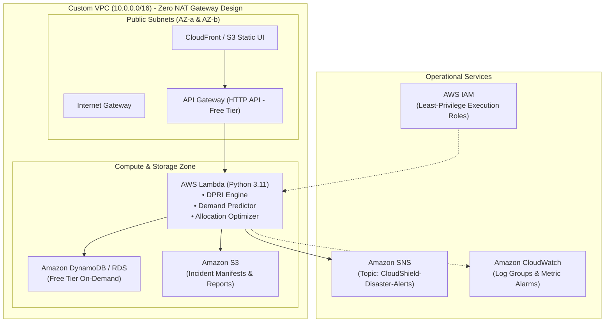

# CloudShield: Target AWS Architecture Specification

> **POLICY STATUS**: ARCHITECTURAL REFERENCE ONLY  
> **OPERATING MODE**: `AWS_MODE=mock` (Zero AWS charges, no resources provisioned without explicit approval)  
> **TARGET REGION**: `ap-southeast-2` (Sydney)

---

## 1. High-Level Target AWS Architecture



---

## 2. Component-by-Component Cloud Mapping

| Subsystem | Local Implementation (Current Active) | Target AWS Service | Configuration Specification | Free Tier Compliance Guardrail |
| :--- | :--- | :--- | :--- | :--- |
| **Frontend** | Static files served via FastAPI (`app/static/`) | **Amazon S3 + CloudFront** | S3 bucket configured for static web hosting; CloudFront distribution with HTTPS. | 5 GB S3 standard storage, 1 TB CloudFront transfer free. |
| **REST API** | Local FastAPI (`app/main.py`) | **Amazon API Gateway (HTTP API)** | Payload compression, JWT authorizer, regional endpoint. | 1,000,000 API calls free per month. |
| **Compute / Logic** | Python Core Engines (`app/core/`) | **AWS Lambda** | Python 3.11 runtime, 512MB RAM, 15-second timeout. | 1,000,000 requests & 3.2M seconds compute free. |
| **Database** | SQLite (`data/cloudshield.db`) | **Amazon DynamoDB** / **RDS PostgreSQL** | If DynamoDB: On-Demand Pay-per-Request.<br>If RDS: single `db.t4g.micro` in Free Tier window. | 25 GB DynamoDB storage free. No provisioned RCU/WCU overages. |
| **Alerts / PubSub** | Local Mock & File Log (`app/core/notification_engine.py`) | **Amazon SNS** | Standard Topic: `CloudShield-Disaster-Alerts`. Email and SMS endpoints. | 1,000,000 publishes and 1,000 email notifications free. |
| **Observability** | Rotating local file logs (`logs/`) | **Amazon CloudWatch** | Log retention capped at **1 day**; 5 standard alarms. | Stays within 5 GB free ingestion; zero detailed monitoring fees. |

---

## 3. VPC and Network Security Group Design

To preserve the **Zero-Unexpected-Charges Policy**, CloudShield deliberately **avoids NAT Gateways** (~$32.85/month):

```
VPC CIDR: 10.0.0.0/16
├── Public Subnet 1: 10.0.1.0/24 (ap-southeast-2a)
├── Public Subnet 2: 10.0.2.0/24 (ap-southeast-2b)
├── Private Subnet 1: 10.0.10.0/24 (ap-southeast-2a)
└── Private Subnet 2: 10.0.20.0/24 (ap-southeast-2b)
```

### Security Groups:
1. **`sg-cloudshield-apigw`**: Ingress HTTPS (443) from 0.0.0.0/0; Egress to Lambda.
2. **`sg-cloudshield-lambda`**: Ingress from API Gateway only; Egress to VPC endpoints or public AWS APIs.
3. **`sg-cloudshield-db`**: Ingress TCP (5432) from `sg-cloudshield-lambda` only; Egress none.

---

## 4. IAM Roles & Security Boundaries

Least-privilege role: `CloudShieldLambdaExecutionRole`:

```json
{
  "Version": "2012-10-17",
  "Statement": [
    {
      "Sid": "DynamoDBAccess",
      "Effect": "Allow",
      "Action": [
        "dynamodb:GetItem",
        "dynamodb:PutItem",
        "dynamodb:UpdateItem",
        "dynamodb:Query",
        "dynamodb:Scan"
      ],
      "Resource": "arn:aws:dynamodb:ap-southeast-2:206238482111:table/CloudShield-*"
    },
    {
      "Sid": "SNSPublishAccess",
      "Effect": "Allow",
      "Action": "sns:Publish",
      "Resource": "arn:aws:sns:ap-southeast-2:206238482111:CloudShield-Disaster-Alerts"
    },
    {
      "Sid": "CloudWatchLogs",
      "Effect": "Allow",
      "Action": [
        "logs:CreateLogGroup",
        "logs:CreateLogStream",
        "logs:PutLogEvents"
      ],
      "Resource": "arn:aws:logs:ap-southeast-2:206238482111:log-group:/aws/lambda/CloudShield-*:*"
    }
  ]
}
```
