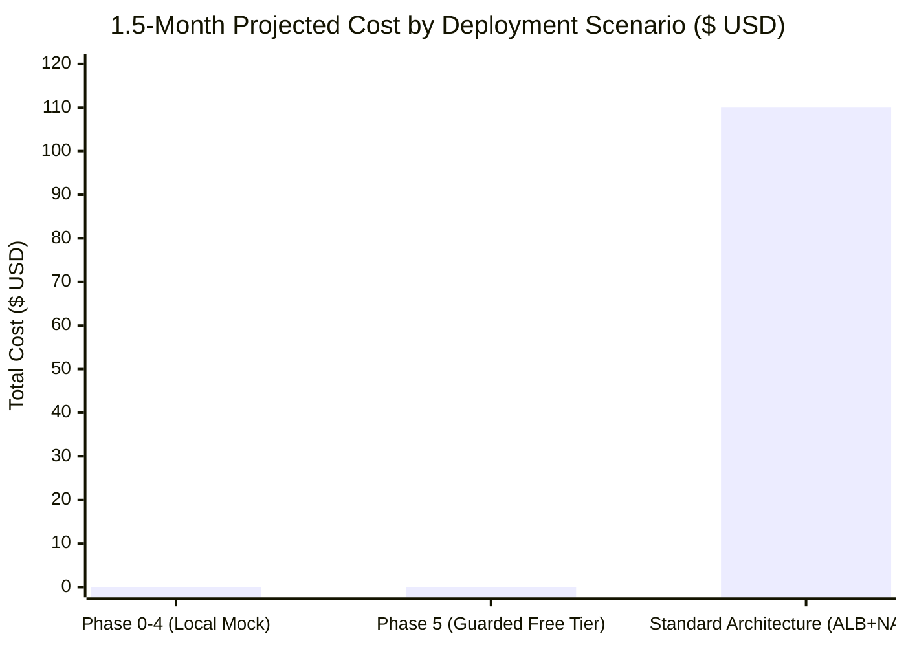

# CloudShield: AWS Deployment Cost & Risk Analysis

> **TARGET TIMELINE**: ~1.5 Months (6 Weeks)  
> **AWS ACCOUNT TYPE**: AWS Free Tier (`206238482111`)  
> **CURRENT MODE**: `AWS_MODE=mock` (Cost = $0.00)

---

## 1. Architecture Cost Matrix (Local vs. Cloud)

| Subsystem | Local/Mock Cost | Free-Tier Compliant Cloud Architecture | Monthly Cloud Cost (Within Limits) | Risk of Overrun if Misconfigured |
| :--- | :--- | :--- | :--- | :--- |
| **Frontend** | $0.00 | S3 Website Hosting + CloudFront (1 TB transfer free) | **$0.00** | LOW (requests within 10M free) |
| **Backend REST API** | $0.00 | AWS Lambda (1M free requests/mo, 3.2M sec compute) + API Gateway HTTP API (1M free calls) | **$0.00** | LOW (throttles configured) |
| **Prediction Engine** | $0.00 | Local Python Service (packaged into Lambda 1024MB memory within 400,000 GB-sec) | **$0.00** | MEDIUM (Lambda timeout loops if unthrottled) |
| **DPRI Calculator** | $0.00 | Local Python Service (Event-driven Lambda) | **$0.00** | LOW |
| **Inventory Store** | $0.00 | DynamoDB (Pay-per-Request / Free Tier 25 GB storage) | **$0.00** | LOW |
| **Queue / Events** | $0.00 | SQS Standard (1M requests free per month) | **$0.00** | LOW |
| **Logging** | $0.00 | CloudWatch Logs (Retention set to 1 day; < 5 GB free) | **$0.00** | MEDIUM (unbounded debug logging can exceed 5 GB) |
| **TOTAL** | **$0.00** | **Fully Serverless Free-Tier Stack** | **$0.00** | **SAFE when guarded** |

---

## 2. Analysis of Critical "Charge Traps" to Avoid

The following AWS services and architectural patterns are **explicitly banned** in CloudShield due to immediate non-free tier charges:

| Dangerous Resource Pattern | Real-World AWS Pricing (Sydney / US) | Monthly Penalty | CloudShield Policy & Safeguard |
| :--- | :--- | :--- | :--- |
| **NAT Gateway** in VPC | $0.045/hour + $0.045/GB processed | **~$32.85 / month** (per NAT GW) | **BANNED**. No private subnets requiring NAT. Use direct Lambda outside VPC or VPC Endpoints if ever approved. |
| **Public IPv4 Allocation** | $0.005/hour per IP (effective Feb 1, 2024) | **~$3.65 / month** (per IP) | **BANNED**. No EC2 with auto-assigned public IPv4. Serverless endpoints use AWS-managed DNS without IPv4 charges. |
| **Application Load Balancer (ALB)** | $0.0225/hour + $0.008/LCU-hour | **~$16.43 to $25.00 / month** | **BANNED**. Use API Gateway HTTP APIs or CloudFront instead of hourly ALBs. |
| **SageMaker Real-Time Endpoint** | `ml.t3.medium` ~$0.05/hour | **~$36.50 / month** | **BANNED**. Run models locally or inside lightweight Lambda functions (never dedicated endpoints). |
| **RDS / Relational Databases** | Even `db.t4g.micro` after 750 free hours = $0.018/hr + storage | **~$15.00+ / month** | **BANNED**. Use DynamoDB Serverless or Local SQLite. |
| **Unattached Elastic IP** | $0.005/hour if not associated | **~$3.65 / month** | **BANNED**. Zero Elastic IPs created. |
| **Detailed CloudWatch Monitoring** | $2.10/metric per month | Variable | **BANNED**. Use standard 5-minute metrics only. |

---

## 3. Projected 1.5-Month Total Cost Scenarios



### Scenario 1: Local-First Development (Phases 0–4)
- **Duration**: ~4.5 weeks
- **AWS Usage**: 100% Mock Adapters (`AWS_MODE=mock`)
- **Expected Cost**: **$0.00**
- **Uncertainty**: 0%

### Scenario 2: Guarded Cloud Verification (Phase 5 - with explicit user sign-off)
- **Duration**: ~1.5 weeks
- **AWS Usage**: Ephemeral Serverless test runs (S3 bucket for build artifacts, single Lambda test invocation, DynamoDB Pay-Per-Request table deleted after test)
- **Expected Cost**: **$0.00** (strictly within Free Tier thresholds)
- **Uncertainty**: < $0.05 (buffer for minimal API calls)

### Scenario 3: Accidental Provisioning (If guardrails were absent)
- **Duration**: 1.5 months
- **Example**: 1 VPC with 1 NAT Gateway + 1 ALB + 1 EC2 t3.medium + Public IPv4
- **Projected Waste**: **~$110.00+**
- **Prevention**: Enforced policy gates in `docs/AWS_COST_SAFETY.md`.

---

## 4. Teardown Verification Protocol

Whenever an approved test resource is deployed to live AWS:
1. Every resource must carry the tag `Project=CloudShield` and `Environment=EphemeralTest`.
2. Immediate teardown command must be verified before the test session concludes.
3. Cost monitoring script checks AWS Cost Explorer:
   ```powershell
   aws ce get-cost-and-usage --time-period Start=(Get-Date).AddDays(-1).ToString("yyyy-MM-dd"),End=(Get-Date).ToString("yyyy-MM-dd") --granularity DAILY --metrics "UnblendedCost"
   ```
