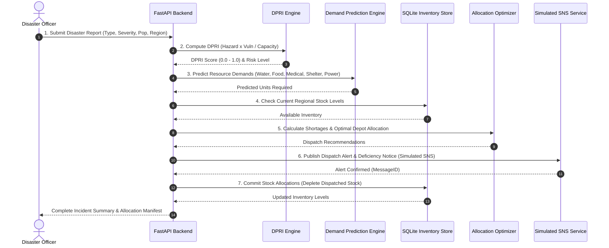

# CloudShield: Revised 3–4 Day Accelerated Architecture & Roadmap

> **DEADLINE**: 3–4 Days  
> **OPERATING PRINCIPLE**: Working end-to-end demo first, reliable simple architecture, zero AWS charges (`AWS_MODE=mock`).

---

## 1. 3–4 Day Milestone Breakdown

| Milestone | Target Timeline | Focus Area | Status |
| :--- | :--- | :--- | :--- |
| **Milestone 1** | **Day 1 (Immediate)** | **Core Workflow Backend & Automated Tests** • DPRI Calculation Engine • Resource Demand Predictor • Shortage Calculator & Allocation Optimizer • Local SQLite Database & Seed Inventory • Simulated SNS Alert Dispatcher • Full Automated Test Suite & Checkpoint Verification | **IN PROGRESS** |
| **Milestone 2** | **Day 2** | **FastAPI Endpoints & Integration** • REST API routes for disaster intake, DPRI, inventory, and allocation • End-to-end integration tests (`disaster → DPRI → demand → shortage → allocation → alert → inventory`) • Swagger / OpenAPI validation | Planned |
| **Milestone 3** | **Day 3** | **Interactive Frontend Dashboard** • Disaster simulation control panel • Live DPRI gauge & risk breakdown • Real-time warehouse inventory table • Allocation recommendation visualizer & dispatch execution button • Live SNS alert feed | Planned |
| **Milestone 4** | **Day 4** | **Documentation, Viva Prep & AWS Integration Blueprint** • Complete Viva & defense guide (`docs/VIVA_PREPARATION.md`) • Target AWS Cloud Architecture specification (IAM, EC2, S3, RDS, SNS, CloudWatch, VPC) • Setup & run instructions for non-technical evaluation | Planned |

---

## 2. The Core 7-Step Workflow

---

## 3. Scope Controls for Deadline Protection

To guarantee delivery within 3–4 days:
1. **No External Microservices**: Single unified Python service serving both the REST API and the Frontend.
2. **Standard Installed Libraries**: Pydantic, FastAPI, SQLite3, NumPy, Pandas, Scikit-learn.
3. **Local Storage / SQLite**: In-memory and local SQLite database for instant zero-config launch.
4. **Local Mock AWS Adapters**: S3 (local file system), DynamoDB/RDS (SQLite), SNS (in-memory logger and event dispatcher).
5. **Zero Paid Cloud Deployments**: All cloud interactions remain in mock mode.
