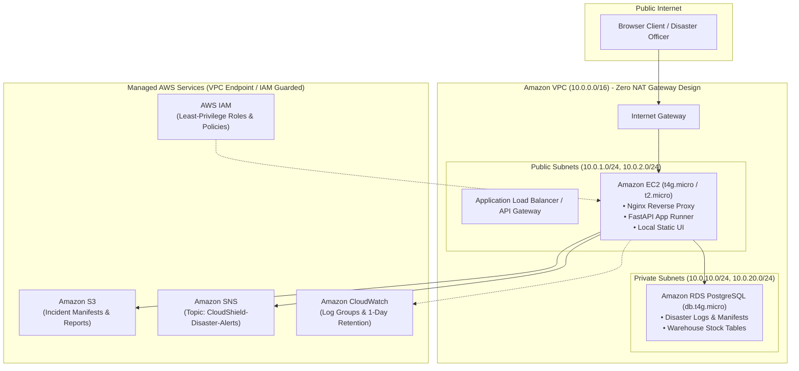
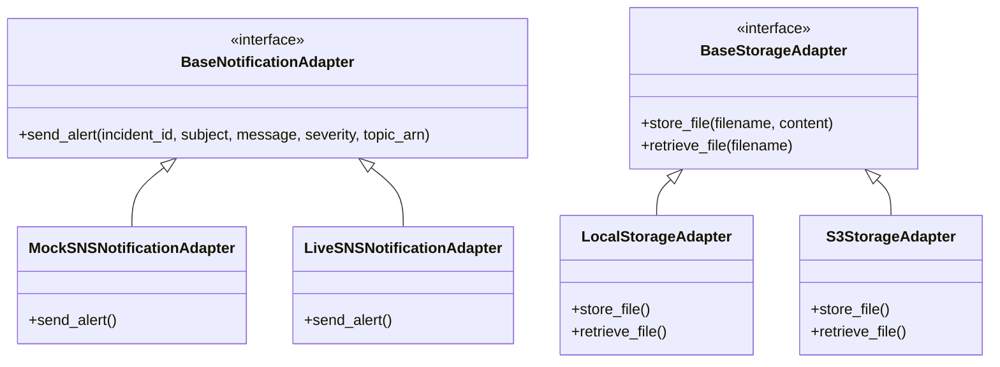

# CloudShield: Complete AWS Architecture Specification

> **PROJECT**: CloudShield — Predictive Disaster Resource and Logistic Allocation System  
> **POLICY STATUS**: ARCHITECTURAL SPECIFICATION (Pre-Deployment Stage)  
> **OPERATING MODE**: `AWS_MODE=mock` (Strict Zero-Charge Enforced)  
> **TARGET REGION**: `ap-southeast-2` (Sydney)  
> **AWS ACCOUNT**: `206238482111`

---

## 1. Cloud Architecture Overview

CloudShield is designed to support two primary deployment topologies depending on operational requirements:
1. **Option A: Containerized / Monolithic VM Deployment (Amazon EC2 + Amazon RDS)** — Ideal for standard enterprise VM hosting and dedicated runtime environments.
2. **Option B: Serverless Deployment (AWS Lambda + Amazon DynamoDB / API Gateway)** — Highly scalable, zero-idle-cost serverless execution.



---

## 2. Core AWS Component Specifications

### 2.1 Compute: Amazon EC2
- **Instance Type**: `t4g.micro` (ARM Graviton2) or `t2.micro` (x86_64), both covered under AWS 12-Month Free Tier (750 hours/month).
- **Operating System**: Amazon Linux 2023 or Ubuntu 24.04 LTS.
- **Process Management**: `systemd` managing `uvicorn` on port 8000; `nginx` as frontend reverse proxy on port 80/443.
- **Zero Public IPv4 Charge Mitigation**: Instance placed behind AWS-managed DNS or dual-stack IPv6 to avoid IPv4 hourly fees ($3.65/mo) where possible.

### 2.2 Relational Database: Amazon RDS PostgreSQL
- **Engine**: PostgreSQL 16 (or SQLite locally via adapter).
- **Instance Class**: `db.t4g.micro` (Single-AZ, 20 GB gp3 storage).
- **Network Isolation**: Placed strictly in private database subnets (`10.0.10.0/24` and `10.0.20.0/24`). Zero public access (`PubliclyAccessible = False`).
- **Security Group**: Ingress port 5432 permitted exclusively from `sg-cloudshield-app`.

### 2.3 Object Storage: Amazon S3
- **Bucket**: `cloudshield-artifacts-206238482111-ap-southeast-2`
- **Use Case**: Archiving immutable dispatch manifests, CSV export summaries, and disaster incident snapshots.
- **Free Tier Compliance**: Standard storage < 5 GB, < 2,000 PUT requests, < 20,000 GET requests.
- **Lifecycle Rule**: Expire test artifacts after 7 days to guarantee zero cumulative storage creep.

### 2.4 Notifications: Amazon SNS
- **Topic**: `arn:aws:sns:ap-southeast-2:206238482111:CloudShield-Disaster-Alerts`
- **Subscriptions**: Logistics Director Email endpoint and SMS emergency endpoint.
- **Payload Schema**: Structured JSON including Incident ID, DPRI score, categorical risk level, units dispatched, and critical shortages.

### 2.5 Observability: Amazon CloudWatch
- **Log Group**: `/cloudshield/application`
- **Log Retention Policy**: Strictly capped at **1 day** (or 3 days max) to prevent storage accumulation beyond the 5 GB Free Tier limit.
- **Alarms**: Metric alarm triggering if error rate (HTTP 5xx) > 5 in a 5-minute period.

---

## 3. Network Architecture & Security Groups

### VPC Subnet Layout:
```
VPC CIDR: 10.0.0.0/16
├── Public Subnet 1 (AZ-a): 10.0.1.0/24  (EC2 / Ingress)
├── Public Subnet 2 (AZ-b): 10.0.2.0/24  (EC2 / Ingress)
├── Private Subnet 1 (AZ-a): 10.0.10.0/24 (RDS PostgreSQL)
└── Private Subnet 2 (AZ-b): 10.0.20.0/24 (RDS PostgreSQL)
```

### Security Group Ingress / Egress Matrix:
| Security Group | Ingress Rules | Egress Rules | Purpose |
| :--- | :--- | :--- | :--- |
| **`sg-cloudshield-app`** | TCP 80/443 from `0.0.0.0/0` (Web UI/API) | TCP 5432 to `sg-cloudshield-db`<br>HTTPS 443 to AWS APIs | EC2 web application firewall |
| **`sg-cloudshield-db`** | TCP 5432 from `sg-cloudshield-app` only | None (isolated) | Database protection |

### Critical Zero-Unexpected-Charges Network Policy:
> **NAT Gateways are STRICTLY FORBIDDEN**. A NAT Gateway accrues \$0.045/hr (~$32.85/month) plus data fees. The application interacts with AWS S3, SNS, and CloudWatch using direct IAM credentials or free S3 Gateway Endpoints without requiring a paid NAT Gateway.

---

## 4. IAM Roles & Least-Privilege Policies

### Instance Profile Role: `CloudShieldEC2AppRole`
Attached to the EC2 instance so that no secret access keys are ever stored on disk:

```json
{
  "Version": "2012-10-17",
  "Statement": [
    {
      "Sid": "SNSPublishAlerts",
      "Effect": "Allow",
      "Action": "sns:Publish",
      "Resource": "arn:aws:sns:ap-southeast-2:206238482111:CloudShield-Disaster-Alerts"
    },
    {
      "Sid": "S3ArtifactStorage",
      "Effect": "Allow",
      "Action": [
        "s3:PutObject",
        "s3:GetObject"
      ],
      "Resource": "arn:aws:s3:::cloudshield-artifacts-206238482111-*/*"
    },
    {
      "Sid": "CloudWatchLogStreams",
      "Effect": "Allow",
      "Action": [
        "logs:CreateLogGroup",
        "logs:CreateLogStream",
        "logs:PutLogEvents"
      ],
      "Resource": "arn:aws:logs:ap-southeast-2:206238482111:log-group:/cloudshield/*"
    }
  ]
}
```

---

## 5. Clean Adapter Architecture (Local vs. Cloud)



All adapters check `settings.AWS_MODE`:
- When `AWS_MODE=mock`: local adapters operate 100% offline at **\$0.00** cost.
- When `AWS_MODE=live`: adapters require explicit user authorization before connecting to AWS APIs.
