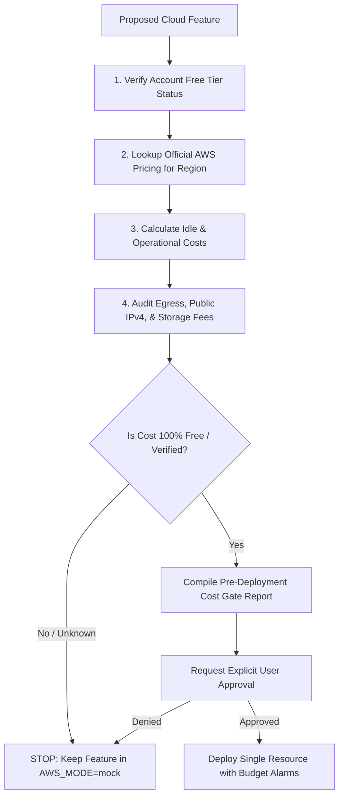

# CloudShield: AWS Zero-Unexpected-Charges Cost Safety Policy

> **STATUS**: ACTIVE & ENFORCED  
> **ACCOUNT**: `206238482111` (assumed-role/AccountFullAccessRole)  
> **DEFAULT REGION**: `ap-southeast-2`  
> **OPERATING MODE**: `AWS_MODE=mock` (Strict Local-First)

---

## 1. Executive Summary & Core Tenets

The **CloudShield** system is designed, developed, and tested under strict AWS cost controls to guarantee **zero unexpected charges** on an AWS Free Tier account. 

### Core Tenets:
1. **Zero Resource Creation Without Explicit Written Approval**: No command, script, CloudFormation, SAM, CDK, or Terraform apply will execute against AWS without the user reviewing and approving the exact resource list, configuration, and cost breakdown.
2. **Local-First Verification**: Every feature (Frontend, Backend APIs, Python Prediction Engine, DPRI Calculations, Inventory Management, Resource Allocation Algorithms) must run, pass tests, and demonstrate full functionality using local mock adapters before any cloud integration is even discussed.
3. **Assume Nothing is Free**: All AWS services, requests, data egress, IPv4 addresses, and storage carry potential charges. If cost or Free Tier eligibility is unknown, it is marked `UNKNOWN` and provisioning is forbidden.
4. **Permanent Mock Default**: `AWS_MODE` is strictly set to `mock`. Switching to `live` requires explicit, deliberate configuration and confirmation.

---

## 2. Absolute Deployment Restrictions

The following restrictions are binding across the entire project lifecycle:

| Restricted Area | Strict Rule |
| :--- | :--- |
| **Approval Gate** | No AWS resource may be created, updated, or deleted without prior explicit approval for that individual operation. |
| **Infrastructure-as-Code** | No automated `apply`, `deploy`, or `sync` commands. Only `dry-run`, `validate`, and `plan` outputs may be generated locally. |
| **High-Cost Architecture Banned** | Prohibited by default: • NAT Gateways (~$32.85/month + data processing) • Elastic Load Balancers / ALBs (~$16–$22/month + LCU) • GPU or non-Free-Tier EC2 instance types • Public IPv4 addresses (~$3.65/month per IP charges introduced by AWS in 2024) • SageMaker hosted endpoints, Bedrock paid models • RDS Multi-AZ or paid database instances |
| **Monitoring & Logging Caps** | CloudWatch log retention capped at 1 day (or mocked locally); no detailed monitoring; no high-frequency metrics. |
| **No Auto-Remediation on Cloud** | Failed deployments will **never** trigger automatic resource retries or fallback provisioning in the cloud. |
| **Destructive Command Audits** | No teardown or cleanup command may run without first listing every target ARN/name and receiving approval. |

---

## 3. Mandatory Cost Gate (Pre-Deployment Protocol)

Before proposing any live AWS provisioning:

### The 8-Point Pre-Deployment Checklist:
1. **Free Tier Eligibility**: Confirm whether the target service falls within the 12-Month Free Tier or Always-Free Tier for this account.
2. **Exact Regional Pricing**: Check pricing for the chosen region (`ap-southeast-2` or `us-east-1`).
3. **Idle Charges**: Identify persistent charges that accrue even if 0 requests are processed (e.g., EBS volume storage, public IPv4 address reservation, unassociated Elastic IPs).
4. **Duration Estimate**: Model expected duration (e.g., 1 hour test window vs. 30 days) and calculate maximum upper-bound cost.
5. **Itemized Resource List**: Tabulate every ARN, service, configuration, and capacity unit.
6. **Hidden Cost Checks**: Specifically verify data egress, public IPv4 hourly fees, CloudWatch ingestion, and API request tiers.
7. **Teardown & Verification Protocol**: Provide the exact CLI command to tear down the resource immediately after testing, plus the read-only check command to verify clean deletion.
8. **Explicit Sign-off**: Wait for affirmative user command before running the deployment command.

---

## 4. Local-First Architecture & Service Mocks

CloudShield provides drop-in local adapters for all AWS touchpoints:

| AWS Target Service | Free Tier Limits (Reference) | Local-First Mock Adapter | Storage / State Location |
| :--- | :--- | :--- | :--- |
| **AWS S3** | 5 GB standard, 20k GETs, 2k PUTs | `LocalFileStorageAdapter` | `data/local_storage/s3/` |
| **AWS DynamoDB** | 25 GB storage, 25 WCU, 25 RCU | `LocalJsonDbAdapter` / SQLite | `data/local_storage/dynamodb/` |
| **AWS Lambda** | 1M free requests, 3.2M sec compute | FastAPI direct service invocation | Local Python process |
| **AWS SQS / SNS** | 1M SQS requests, 1M SNS publishes | `LocalQueueAdapter` (in-memory FIFO) | `data/local_storage/queues/` |
| **AWS CloudWatch** | 10 alarms, 5 GB log ingestion | `LocalStructuredLogger` (Rotating files) | `logs/` |

---

## 5. Emergency Incident Response & Containment

If unexpected cloud activity or resource creation is suspected:

1. **Immediate Execution Freeze**: Halt any running deployment tasks immediately.
2. **Read-Only Inventory Scan**: Run read-only enumeration scripts (`aws ec2 describe-instances`, `aws s3 ls`, `aws dynamodb list-tables`).
3. **Teardown Execution**: Destroy any orphan resources using specific, user-confirmed delete commands.
4. **Log Review**: Inspect AWS CloudTrail (Free Tier event history) to determine the exact origin of the provisioning event.
